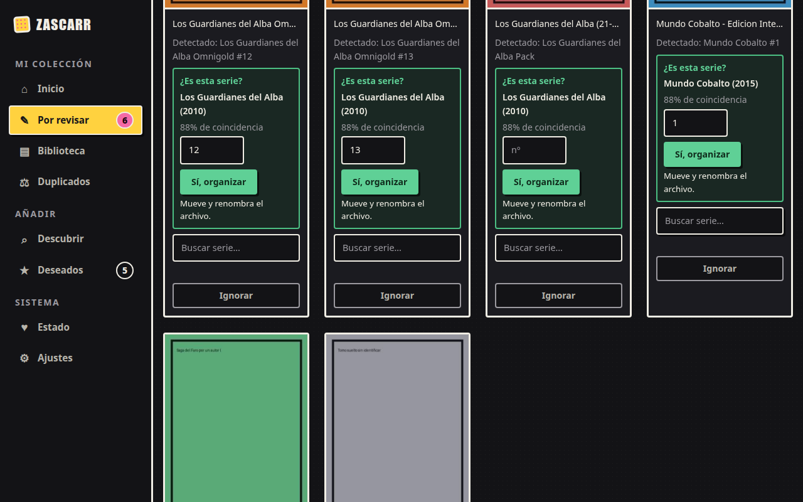
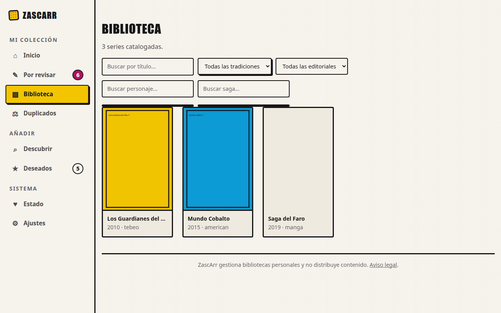
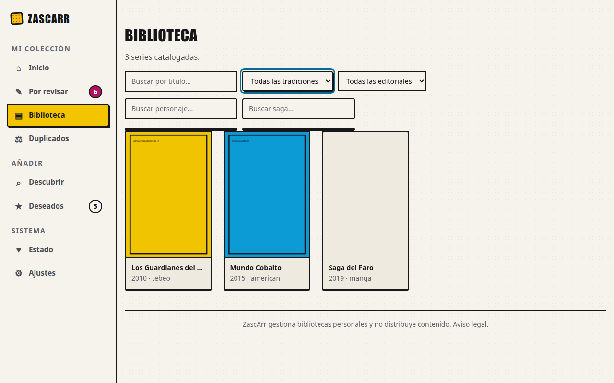
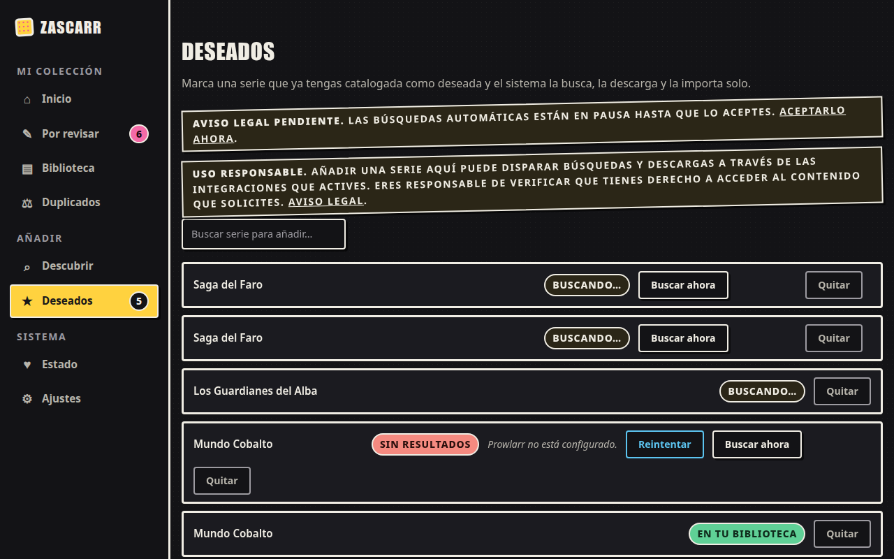
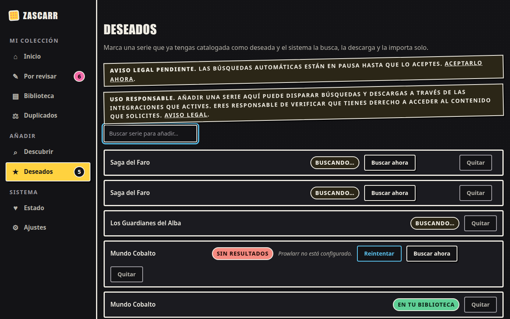

# Evidencia de U11 (#198): foco visible y nombre accesible

Capturas y mediciones **antes/después** de la PR #209, para que la revisión no dependa de capturas
locales. Fecha: 2026-10-15.

| Dato | Antes | Después |
|---|---|---|
| Código de la aplicación | `main` en `cd00093` | `claude/u11-foco-etiquetas` en `4e18ffc` (esta carpeta se añade encima y no toca código) |
| Marca en el `web.css` servido | sin «U11» (`web_css_con_u11: false`) | con «U11» (`true`): la imagen en marcha lleva el cambio |
| Entorno | ensayo aislado `docs/design/ui-baseline/ensayo.sh` (Compose `zascarr-uibase`, **Postgres real**, datos **sintéticos** de `sembrar.py`, app en `127.0.0.1:18000`) | el mismo, rehecho desde cero |
| Navegador | Google Chrome 154.0.8037.92 headless por CDP, 1280 × 800, escala 1 | el mismo |
| Herramienta | [`capturar_u11.py`](capturar_u11.py) (capturas) y [`orca_u11.py`](orca_u11.py) (lector de pantalla) | las mismas |

**Cómo llega el foco:** con una pulsación **real** de Tab (`Input.dispatchKeyEvent`) desde el
control anterior, no con `element.focus()`, para que aplique `:focus-visible` como con un teclado.
**De dónde sale el nombre:** del árbol de accesibilidad de Chromium (`Accessibility.getPartialAXTree`),
que es lo que el navegador entrega a un lector de pantalla. Los datos en bruto están en
[`datos-antes.json`](datos-antes.json) y [`datos-despues.json`](datos-despues.json).

## Resultados

| Vista · tema · URL | Antes | Después |
|---|---|---|
| Por revisar · oscuro · `/ui/pendientes` (buscador de la tarjeta «Mundo Cobalto») | sin anillo, solo una sombra de **1,14:1**; nombre `Buscar serie…`, el mismo en todas las tarjetas | anillo continuo de 3 px, **8,67:1**; nombre `Serie de «Mundo Cobalto - Edicion Integral 01 [Equipo X].cbz»` |
| Biblioteca · claro · `/ui/biblioteca` (selector de tradición) | sin anillo (sombra de tinta, 16,14:1); nombre **vacío**; 2 de 5 controles sin nombre | anillo **5,39:1**; nombre `Tradición`; 0 de 5 sin nombre |
| Deseados · oscuro · `/ui/wishlist` (buscador) | sin anillo, sombra de **1,08:1**; nombre `Buscar serie para añadir…` (el placeholder) | anillo **9,37:1**; nombre `Buscar serie para añadir a Deseados` |

Nota: antes, Chromium **sí** daba nombre a los `input` de Por revisar y Deseados, porque usa el
placeholder como último recurso. El problema era que el nombre se repetía en todas las tarjetas
(`Buscar serie…`, `nº`) y desaparecía visualmente al escribir. Los `select` de Biblioteca no tienen
placeholder, así que su nombre quedaba vacío.

| | Antes | Después |
|---|---|---|
| Por revisar (oscuro) |  |  |
| Biblioteca (claro) |  |  |
| Deseados (oscuro) |  |  |

## Lo que esto cubre y lo que no

- **PASS** foco visible ≥ 3:1 en los dos temas y nombres accesibles calculados por Chromium.
- **PASS** el DOM después de los intercambios HTMX de estas pantallas: lo comprueba
  `tests/test_web_nombre_y_foco.py`; además, en el primer ensayo de la PR se buscó «Mundo» en
  Por revisar y el campo «nº» insertado salió con nombre `Número en «Mundo Cobalto»`.
- **PASS** lector de pantalla real: **Orca 50.2** (GNOME, Wayland) con Google Chrome 154 con ventana,
  contra el ensayo con el código de `4e18ffc` (ver «Con Orca» más abajo).
- **NOT RUN** NVDA (Windows) y VoiceOver (macOS/iOS).
- **NOT RUN** la Raspberry Pi del responsable y los móviles reales.

## Con Orca (lector de pantalla real)

Herramienta: [`orca_u11.py`](orca_u11.py). Arranca Orca con su registro de depuración y una
configuración **propia y temporal**: es una base de dconf aparte, no toca la del usuario y se borra
al terminar. Desactiva «leer todo al cargar», porque mientras lee Orca ignora los cambios de foco.
Después abre Chrome con accesibilidad y mueve el foco con pulsaciones reales de Tab por CDP. Lo que
se anota es lo que Orca mandó al sintetizador (`SPEECH OUTPUT`). Resultados en bruto:
[`orca-habla-1.json`](orca-habla-1.json) y [`orca-habla-2.json`](orca-habla-2.json). La pasada 2
es la salida directa de la versión publicada de la herramienta. La pasada 1 se hizo con una versión
anterior, que además intentaba la consulta AT-SPI descrita abajo; de su salida se quitaron ese campo,
la ruta del registro temporal y los datos de la voz que acompañan a cada frase.

| Paso | Lo que dijo Orca (pasada 1) | Pasada 2 |
|---|---|---|
| Por revisar, buscador de la 4.ª tarjeta | «Serie de «Mundo Cobalto - Edicion Integral 01 [Equipo X].cbz», entry, Buscar serie…» | igual |
| Por revisar, «nº» de la 1.ª tarjeta | «Número de «Los Guardianes del Alba Omnigold 12 [CRG].cbz», entry, 12, seleccionado requerido» | igual |
| Biblioteca, 5 filtros seguidos | «Buscar por título, entry» · «Tradición, combo box, Todas las tradiciones» · «Editorial, combo box, Todas las editoriales» · «Buscar personaje, entry» · «Buscar saga, entry» | igual, salvo que **no verbalizó** el primero (ver nota) |
| Deseados, buscador | «Buscar serie para añadir a Deseados, entry, Buscar serie para añadir…» | **no verbalizó** (ver nota) |

**Nota sobre la pasada 2.** En los dos pasos sin voz, el foco sí llegó al campo correcto y Orca lo
tenía con el nombre correcto (`entry: 'Buscar serie para añadir a Deseados'` en su registro). Lo
que pasó es una carrera de eventos: Chrome emitió `text-caret-moved` antes que `focused`, Orca movió
el foco en silencio (`notify: False`) y luego descartó el evento de foco. No depende del marcado
(la pasada 1 lo anunció) y no se ha intentado esquivar.

**Indicador «Buscando…» en reposo:** en Deseados, la `visibility` calculada de los 3
`.htmx-indicator` es `hidden` (las insignias de estado, que son V8, sí son visibles). Un intento de
contarlos en el árbol AT-SPI no encontró ni las insignias visibles (el control positivo), así que no
prueba nada y se retiró de la herramienta. Para el criterio 4 queda la `visibility` calculada y
la prueba de CSS.

## Repetirlo

```bash
export UI_BASE_DATOS=/ruta/nueva/de/ensayo
docs/design/ui-baseline/ensayo.sh preparar
python3 docs/design/ui-u11/capturar_u11.py despues http://127.0.0.1:18000 /ruta/de/salida
docs/design/ui-baseline/ensayo.sh bajar
```
