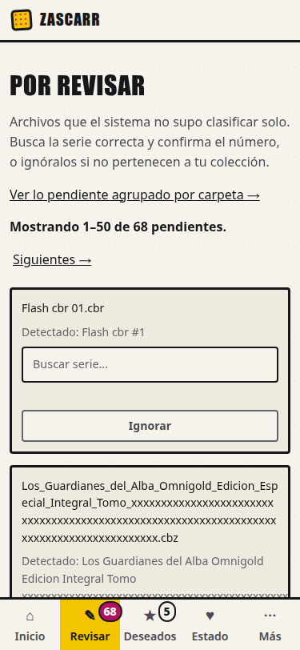
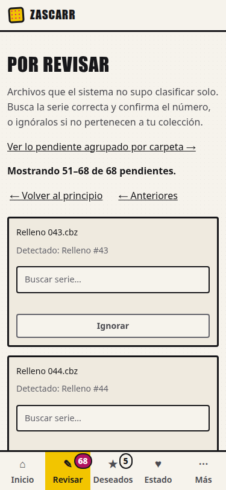
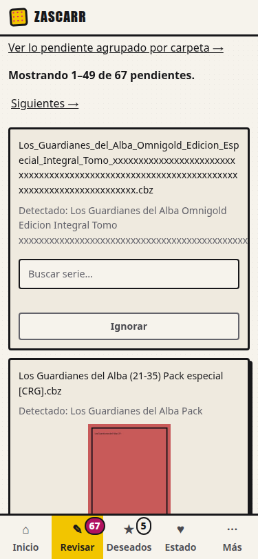

# Evidencia de U12 (#199): «Por revisar» a escala, en la aplicación integrada a 375 px

Mediciones en **navegador real** de la rama `claude/u12-pendientes-escala` (`31acfce`), 2026-10-15. Ficha de
referencia: `docs/design/benchmark-U12-pendientes-escala.md` (PR #213).

| Dato | Valor |
|---|---|
| Entorno | ensayo aislado `docs/design/ui-baseline/ensayo.sh` (Compose `zascarr-uibase`, **Postgres real**, `127.0.0.1:18000`), rehecho desde cero para esta ejecución |
| Navegador | Google Chrome 154.0.8037.92 headless por CDP; **emulación de viewport** 375 × 812 con `mobile=true` (no es un móvil real) |
| Herramienta | [`capturar_u12.py`](capturar_u12.py): clics **reales** (`Input.dispatchMouseEvent`) y `confirm()` aceptado por el protocolo |
| Datos en bruto | [`datos.json`](datos.json) |
| Datos | **sintéticos**: los 6 pendientes del ensayo (con portada real) + un `.cbr`, un nombre de 158 caracteres sin espacios y 60 archivos de relleno **cuyo fichero no existe**. Total: 68 |

## Resultados

| Criterio de la ficha | Medido | Resultado |
|---|---|---|
| Rango y total (caso 1) | «Mostrando 1–50 de 68 pendientes.» | PASS |
| Navegación con clics reales (caso 4) | «Siguientes →» → «Mostrando 51–68 de 68» (18 tarjetas); «← Anteriores» → «Mostrando 1–50 de 68» | PASS |
| Rango sin recargar tras resolver (caso 7) | «Ignorar» (con `confirm`) → «Mostrando **1–49 de 67**»; 1 sola navegación de documento; el refresco pidió `/ui/pendientes/rango?primero=…&ultimo=…` (**`hx-include` funciona en htmx 4**) y respondió 200 | PASS |
| Sin scroll horizontal a 375 px (12) | `scrollWidth` 375 = `clientWidth` 375, **con** el nombre de 158 caracteres sin espacios | PASS |
| Nombre íntegro (12) | El nombre largo mide 87 px de alto (3 líneas), `text-overflow` ≠ `ellipsis`, `white-space` ≠ `nowrap`, cabe en su caja | PASS |
| Primer pantallazo con nombre completo (11) | El nombre de la primera tarjeta está entero dentro de los 812 px | PASS (la primera tarjeta es el `.cbr`; ver nota) |
| Ausencia conocida (9) | La tarjeta del `.cbr` **no** tiene ``, ni bloque de portada, ni la cadena `/portada` | PASS |
| Disponible (11) | La portada mide **120 × 180** y está **debajo** del nombre | PASS |
| Desconocida sin hueco (10) | **43 portadas** que fallan, todas con **0 px** de alto; sin `onerror` en la página | PASS (Chrome) |
| Peticiones de portada | 49 para 50 tarjetas (la del `.cbr` no pide): 6 × 200 y 43 × 404 | informativo |

  

## Lo que esto NO acredita

- **Los 43 × 404 son un artefacto de los datos de relleno** (su fichero no existe), **no** una medición de la
  instalación real. La ficha sigue sin saber cuántos de los pendientes reales fallan ni por qué.
- **Solo Chrome 154.** Firefox y Safari (incluido iOS): **NOT RUN**. El colapso de la portada rota a 0 px está medido
  aquí en la app integrada, pero solo en ese navegador.
- Viewport **emulado**, no un teléfono real; la Pi del responsable y un lector de pantalla: **NOT RUN**.
- Un `.cbz` sin imágenes o corrupto **sigue costando una petición 404**: es la incompatibilidad declarada en la ficha
  (saberlo de antemano exige I/O por archivo o una columna «tiene portada»).

## Dos hallazgos de la implementación (no estaban en la ficha)

1. **`files.imported_at` admite NULL** en la BD real: la migración inicial no pone `NOT NULL`, aunque el modelo no
   declare `Optional`. La ficha afirmaba lo contrario. Con un cursor, una fila con NULL daba un 500 y quedaría fuera
   de toda comparación. Se ordena y compara por `COALESCE(imported_at, 1970)`; prueba con Postgres real que falló antes.
2. **El `confirm()` de «Ignorar» bloquea el clic** hasta que se responde: la verificación automática lo acepta por el
   protocolo, como haría la persona.
