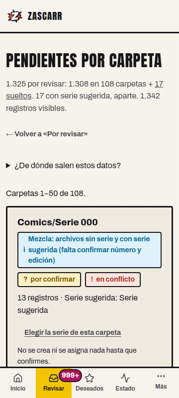
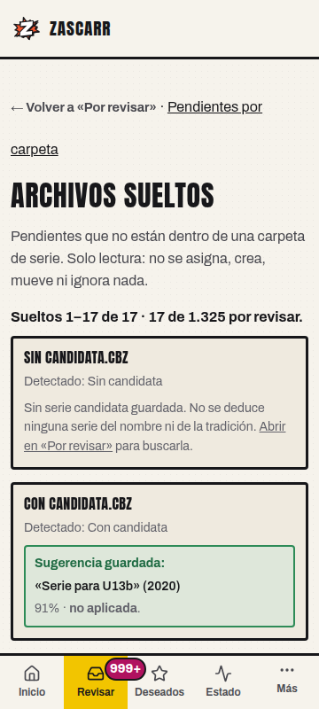
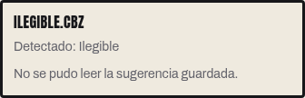

# Verificación de navegador — U13a + U13b

> **Estado:** evidencia de aceptación registrada. No declara `PASS` de lector de pantalla, cinco segundos, rendimiento, Pi ni despliegue.
> **SHA verificado:** `17f0da9fb0cafedf126db5a47672523e24b789f1` (`main` tras fusionar #293 y #299).
> **SHA de `main` al registrar la evidencia:** `b59b00c436fc5067f3d752f3ddd76c201335fab4`; el único cambio posterior es #306 (documentación, bancos de medición y pruebas de formatos), que no toca U13a/U13b.
> **Fecha:** 2026-10-22.
> **Alcance:** navegador real headless, base de datos sintética y biblioteca de prueba. No se ha usado la biblioteca real, staging ni la Pi.

## 1. Entorno

| Pieza | Valor |
|---|---|
| Navegador | Chromium real en modo headless, controlado con Playwright 1.64.0 (`chromium-1234`) |
| Viewports | 1280×900 para el recorrido y 360×800 para la comprobación estrecha |
| Servidor | `uvicorn` local sobre el árbol de `17f0da9` |
| Base de datos | PostgreSQL 15 real, base desechable `zascarr_test_browser`, migrada a `head` |
| Biblioteca | `/biblioteca-de-prueba` (sintética; sin acceso a biblioteca real) |
| Autenticación | `AUTH_MODE=none`, solo para la prueba local |
| Datos | Fixture sintético descrito en §2; sin red externa ni fuentes reales |

## 2. Fixture sintético (y su diferencia con el de referencia)

El fixture de referencia de U13a/U13b es **1.322 A** (1.308 en 108 carpetas + 14 sueltos) y **17 B**. Para esta verificación se añadieron **3 sueltos sintéticos** en `Comics/_Omnibus` con los tres estados de candidata de U13b; por eso el fixture usado es:

- **1.325 A**: 1.308 en 108 carpetas + **17 sueltos** (14 de la raíz + 3 de `_Omnibus`).
- **17 B**: registros con serie sugerida, contados aparte.
- **1.342 registros visibles** en total.

Invariantes comprobadas:

- `1.308 + 17 = 1.325` A.
- `1.325 + 17 = 1.342` visibles, con los 17 B aparte.
- El fixture **no es** el de referencia 1.322/14; la diferencia son los 3 sueltos usados para los estados de U13b.

## 3. U13a — entrada por carpetas

Cabecera observada:

> **1.325 por revisar: 1.308 en 108 carpetas + 17 sueltos. 17 con serie sugerida, aparte. 1.342 registros visibles.**

| Comprobación | Resultado |
|---|---|
| API sin filtro | **110 grupos**; **108 carpetas útiles**; grupo raíz `Comics` con `carpeta_contextual: None`. |
| HTML con `solo_utiles=True` | **50 tarjetas** en la página 1; el grupo raíz `Comics` no aparece entre los 50 títulos pintados. |
| Paginación | **1–50**, **51–100** y **101–108** de 108; 50 + 50 + 8 tarjetas; no hay «Siguiente» en la última. |
| Página invalidada | `?limite=50&desplazamiento=1000` muestra «ESTA PÁGINA YA NO EXISTE», cero tarjetas y enlace a la última página válida (`desplazamiento=100`). |
| Teclado | 12 pulsaciones de Tab recorren el enlace de salto, la navegación, los enlaces y los `
` sin trampa. Enter sobre «Siguiente» navega a `desplazamiento=50`. También se comprobó a 360 px. |
| 360 px | `document.documentElement.scrollWidth <= window.innerWidth`; sin desplazamiento horizontal. |

## 4. U13b — cola de sueltos

- **17 tarjetas**; rango **«Sueltos 1–17 de 17 · 17 de 1.325 por revisar.»**
- Los tres estados de candidata:

| Estado | Archivo | Texto comprobado |
|---|---|---|
| Candidata válida | `Con candidata.cbz` | «Sugerencia guardada: «Serie para U13b» (2020)», **91% · no aplicada**. |
| Sin candidata | `Sin candidata.cbz` | «Sin serie candidata guardada.» |
| Candidata ilegible | `Ilegible.cbz` | «No se pudo leer la sugerencia guardada.» |

- Sin respuesta 503 y sin errores de consola.
- Enter desde la cola volvió a «Pendientes por carpeta».
- A 360 px no hay desbordamiento horizontal.

## 5. Capturas

U13a a 360 px:

U13b a 360 px (primeros estados):

Detalle del estado de candidata ilegible a 360 px:

## 6. Reproducibilidad

La verificación se hizo con:

1. una base PostgreSQL desechable migrada a `head`;
2. el fixture sintético de §2;
3. `uvicorn` local sobre `17f0da9`, sin biblioteca real;
4. Chromium headless de Playwright, con las aserciones de §3 y §4;
5. capturas a 360 px de ancho.

No se ha medido rendimiento ni se ha ejecutado un lector de pantalla. Esas comprobaciones siguen fuera de esta evidencia.

## 7. Límites explícitos

| Comprobación | Estado |
|---|---|
| Navegador real (Chromium headless) | **PASS** para el recorrido descrito |
| 360 px | **PASS** para las dos vistas |
| Teclado | **PASS** para el recorrido descrito |
| Lector de pantalla (Orca/NVDA/VoiceOver/TalkBack) | **NOT RUN** |
| Prueba de cinco segundos con una persona | **NOT RUN** |
| Rendimiento de U13a/U13b | **NOT RUN**; estas capturas no lo acreditan |
| Pi, staging, biblioteca real, despliegue | **NOT RUN / no tocados** |

La verificación se hizo con Chromium headless, no con el panel de navegador de escritorio de OpenCode, que no estaba conectado. No se presenta como evidencia de lector de pantalla ni de interacción humana cronometrada.
