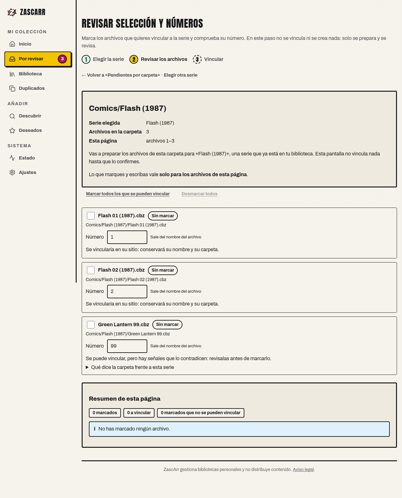
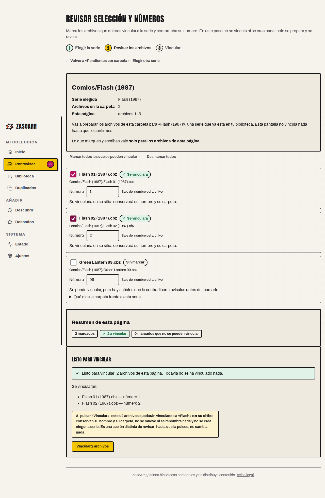
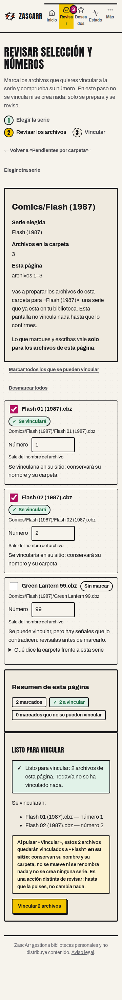
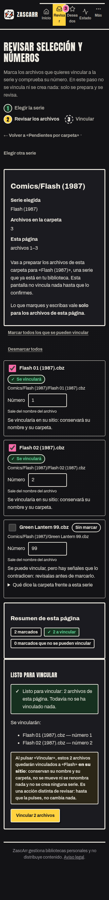
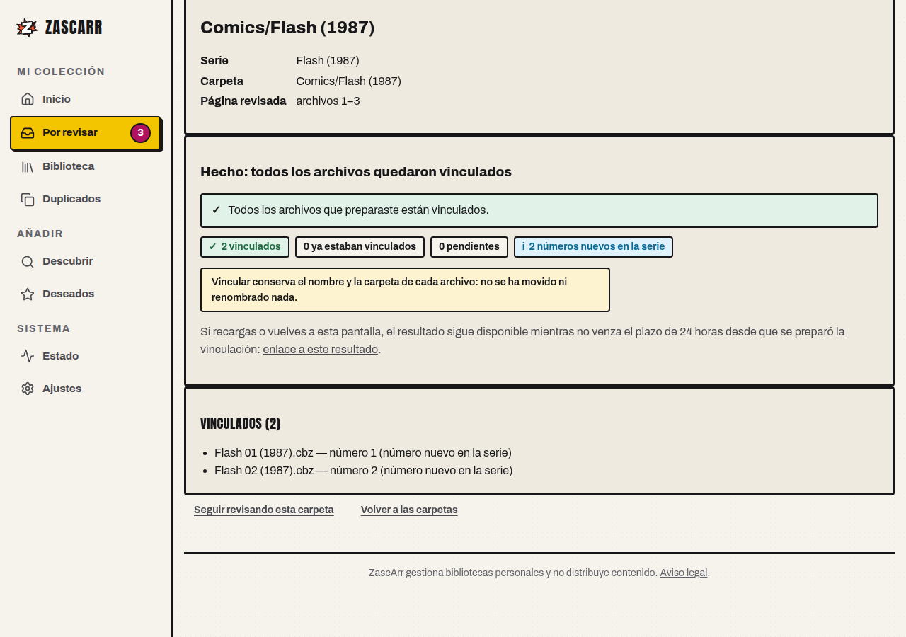
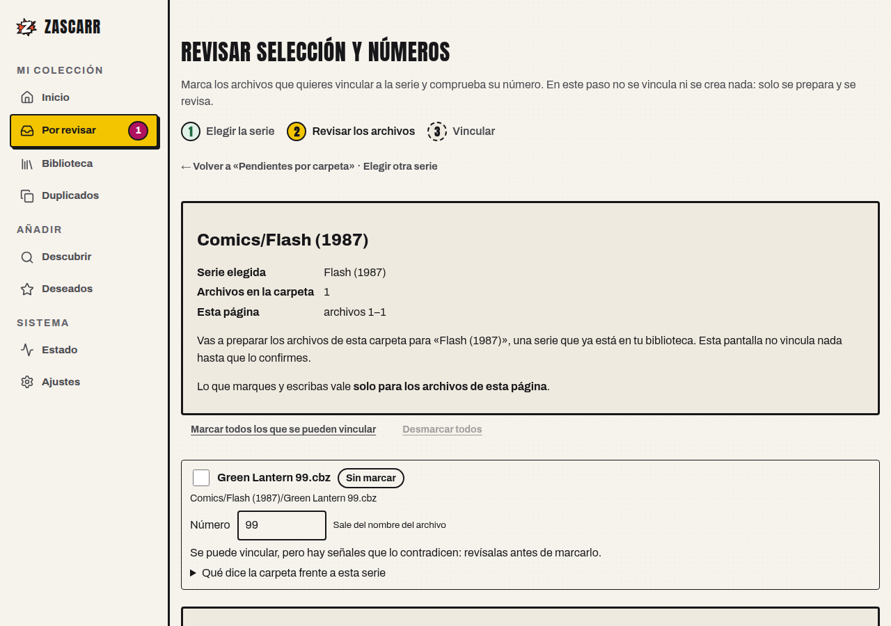

# Verificación de navegador — U13c (#289)

> **Estado:** evidencia de navegador registrada. No declara `PASS` de lector de pantalla, prueba de cinco segundos, rendimiento DoD en la Pi ni despliegue.
> **SHA del árbol verificado:** `a5d45c5bfb81a713cf2cb14fd4c3e2421a343569` (`u13c-289-carpeta-mixta`, merge de `main` `190bd70`; incluye #310).
> **Fecha:** 2026-10-23.
> **Alcance:** Chromium real en modo headless, PostgreSQL 15 real y una biblioteca sintética. No se ha usado la biblioteca real, staging, la Pi ni la red externa.

## 1. Entorno

| Pieza | Valor |
|---|---|
| Navegador | Chromium `chromium-1234`, Playwright 1.64.0, headless |
| Viewports | 1280×900 y 360×800; claro y oscuro en 360 |
| Servidor | `uvicorn` 0.54.0 local, `--lifespan off`, sobre el árbol del SHA verificado |
| Base de datos | PostgreSQL 15.19 en contenedor desechable, migrada a `head` |
| Biblioteca | `/tmp/opencode/zascarr-u13c-browser/library` (sintética) |
| Autenticación | `AUTH_MODE=none`, solo para la prueba local |
| Datos | Fixture de tres archivos descrito en §2; sin biblioteca real ni fuentes externas |

## 2. Fixture

La carpeta de la prueba es `Comics/Flash (1987)` y contiene tres archivos reales en disco:

- `Flash 01 (1987).cbz` y `Flash 02 (1987).cbz`, que corresponden a la serie local **Flash (1987)**.
- `Green Lantern 99.cbz`, ajeno a esa serie, que el servicio marca como `con_conflicto_de_carpeta` y deja marcable.

La base contiene además **Batman (1940)** como serie señuelo, para que la búsqueda local no tenga una sola opción. El fixture es el mínimo de tres archivos que pide el criterio 3 de #289; **no** es el fixture de 1.325/17 de U13a/U13b ni el de 155 archivos de la medición de rendimiento.

## 3. Recorrido comprobado

| Paso | Qué se comprobó | Resultado |
|---|---|---|
| 1. Entrada por tarjeta | «Pendientes por carpeta» muestra `3 por revisar: 3 en 1 carpeta + 0 sueltos. 0 con serie sugerida, aparte. 3 registros visibles.` y una sola tarjeta para `Comics/Flash (1987)` | PASS local |
| 2. Búsqueda local | «Elegir la serie de esta carpeta» abre el asistente sin consultar fuentes; la búsqueda «Flash» devuelve `Flash (1987)` sin preselección y con el `series_id` local correcto | PASS local |
| 3. Revisión inicial | Tres filas; el ajeno muestra `con_conflicto_de_carpeta`, el conflicto de carpeta visible, ningún archivo marcado y ningún token | PASS local |
| 4. Marcar dos | Se marcan solo los dos Flash; el ajeno sigue visible y sin marcar. La pantalla dice `2 marcados`, `2 a vincular` y `Listo para vincular`; el lote lleva token | PASS local |
| 5. 360 px, tema claro | Tres filas, sin desplazamiento horizontal; el recorrido de teclado llega a las casillas, a los números y a los botones; la selección de dos se mantiene | PASS local |
| 6. 360 px, tema oscuro | `prefers-color-scheme: dark` activo, fondo `rgb(19, 19, 22)`, sin desplazamiento horizontal y misma selección de dos | PASS local |
| 7. Confirmar | `POST /confirmar` devuelve `vinculados_todos`; el resultado dice `2 vinculados`, nombra los dos Flash y no incluye al ajeno | PASS local |
| 8. Volver a la carpeta | Los dos vinculados dejan de aparecer como pendientes; solo queda `Green Lantern 99.cbz`, con su estado `con_conflicto_de_carpeta`, visible y sin marcar | PASS local |

No hubo errores de consola, `pageerror` ni respuestas 503. El texto visible de la revisión no contiene `token`, `series_id`, `payload`, `endpoint`, `UUID`, `hash` ni `cursor`. La comprobación 8 confirma el hallazgo ya anotado en `u13c-aceptacion-289.md`: tras vincular, los archivos vinculados salen de la revisión de pendientes y el ajeno sigue accesible con su estado real.

## 4. Capturas

### Revisión inicial, 1280 px

### Dos Flash marcados y el ajeno visible, 1280 px

### La misma revisión a 360 px, tema claro

### La misma revisión a 360 px, tema oscuro

### Resultado de la confirmación

### Después de confirmar: solo queda el ajeno

## 5. Límites de esta evidencia

- **PASS local de navegador** para este recorrido, estos dos viewports y los temas claro/oscuro. No se declara `PASS` de lector de pantalla, de la prueba de cinco segundos, de rendimiento en la Pi ni de despliegue: siguen **NOT RUN**.
- La verificación **no se hereda** de U13a/U13b (#309); es una ejecución propia sobre el árbol de #289.
- **No ha hecho falta cambiar el copy.** El recorrido existente ya distingue «Elegir la serie», «Preparar los archivos» y «Vincular», y no añade ninguna acción nueva antes de elegir serie (D3).
- No se cambia `src/`, no se invalidan tokens (D1), no se excluye automáticamente al ajeno (D2) y no se toca la biblioteca real, staging ni la Pi.
- Los scripts de siembra y de Playwright fueron herramientas locales de esta verificación; la evidencia persistente son las capturas y esta ficha. El fixture descrito permite repetirla sobre cualquier base de pruebas.
