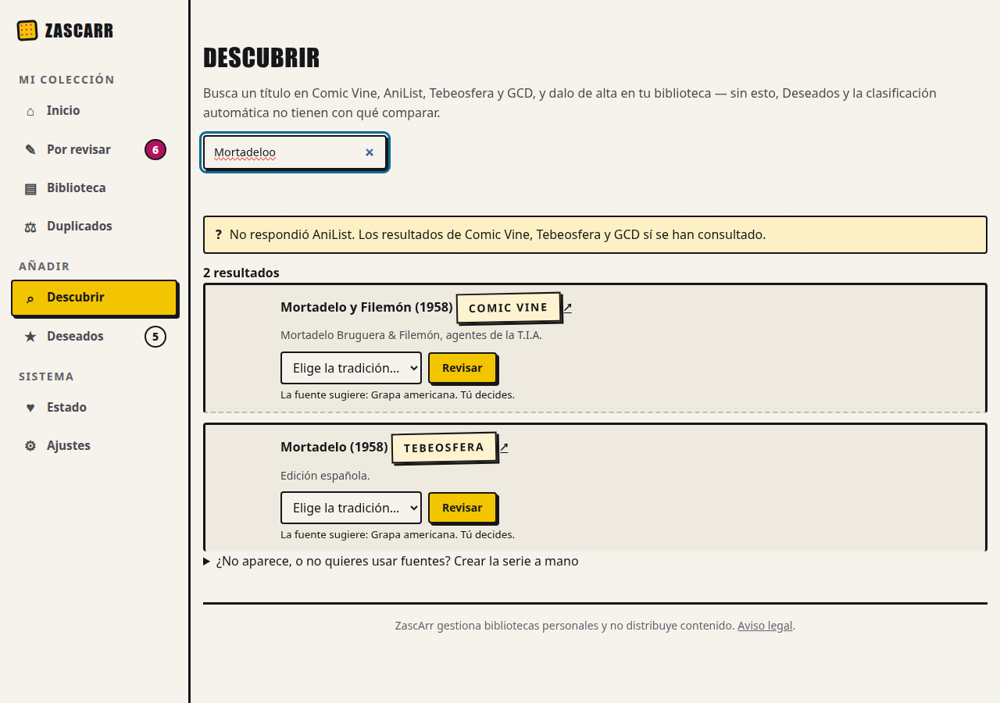
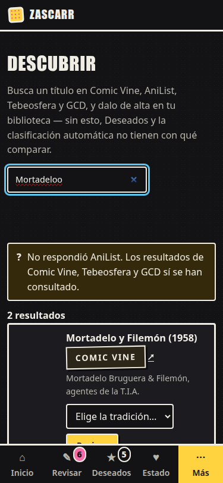

# Evidencia de U14 (#201): Descubrir, progreso y resultados limpios, en navegador real

Mediciones de la rama `claude/u14-descubrir`, 2026-10-16. Ficha: `docs/design/benchmark-U14-descubrir-estados.md` (PR #216).

| Dato | Valor |
|---|---|
| Navegador | Google Chrome 154.0.8037.92 headless por CDP; escritorio 1280×900 y móvil 375×812 (**emulación de viewport**), claro y oscuro |
| Entorno | ensayo aislado `docs/design/ui-baseline/ensayo.sh` (Postgres real), rehecho desde cero para esta ejecución |
| Herramientas | [`fragmentos.py`](fragmentos.py) (genera la página y los fragmentos con la ruta real) y [`capturar_u14.py`](capturar_u14.py) |
| Datos en bruto | [`datos.json`](datos.json) |

## Qué es real y qué es simulado (importa)

- **Real:** hoja de estilos, htmx, plantilla base, el navegador y los **clics y teclas por el protocolo**; y, del ensayo, la
  página con las fuentes apagadas (captura `0-ensayo-fuentes-apagadas.png`).
- **Simulado:** el ensayo tiene las cuatro fuentes **apagadas a propósito** y su red no está aislada, así que **no las
  encendí** (serían consultas reales a sitios externos; Tebeosfera es una asociación sin ánimo de lucro). La página «con las
  cuatro fuentes» y los resultados los **genera la ruta real** (`fragmentos.py`, con `DiscoveryService.search_detallada`
  sustituido por una `Busqueda` ya calculada) y se sirven al navegador con `Fetch.fulfillRequest`. La **espera** de 0,5–1,5 s
  también es simulada (el servidor responde al instante; el navegador la retiene).
- Por tanto esto acredita la **presentación y el comportamiento del navegador**, **no** el tiempo ni el contenido de las fuentes.

## Resultados

| Criterio de la ficha | Medido | Resultado |
|---|---|---|
| 1. Progreso a los 400 ms | Con la respuesta retenida 0,5 y 1,5 s, el indicador pasó a visible **396–431 ms** después de empezar la petición (4 mediciones) y desaparece al terminar | PASS |
| 1. Sin parpadeo | Con una respuesta de 12–16 ms el indicador **nunca llegó a verse** (muestreo cada 20 ms) | PASS |
| 1. Fuentes nombradas | «Buscando en Comic Vine, AniList, Tebeosfera y GCD…», solo las encendidas; con el ensayo real (todo apagado), no hay indicador y la página lo dice | PASS |
| 2. Una sola región viva, fuera del destino | 1 `aria-live` en la página, **antes y después** de buscar; 0 dentro de `#resultados-descubrir`; la respuesta la actualiza por `hx-swap-oob` | PASS |
| 2. Sin duplicar a la vista | La región está **oculta a la vista** (`sr`: ~1×1 px) y el recuento visible es aparte (`aria-hidden`) | PASS |
| 3. Texto limpio | `
…<a>Bruguera</a> &amp; Filemón…<script>` → «Mortadelo Bruguera & Filemón, agentes de la T.I.A.», sin `<`/`>` | PASS |
| 4. Fuente legible | «Comic Vine» (no `comic_vine`/`COMIC_VINE`) | PASS |
| 5. Select del sistema | Oscuro: fondo `rgb(19,19,22)`, texto `rgb(240,237,228)`, borde 2 px, **42 px** de alto; claro: fondo `rgb(246,243,236)`. Antes: el control nativo gris | PASS (el contraste lo comprueba además `test_web_css_contraste`) |
| 6. Enlace | Nombre en el **árbol de accesibilidad de Chromium**: «Ver la ficha de «Mortadelo y Filemón» en Comic Vine (se abre en otra pestaña)» | PASS |
| 7. Errores por fuente | Una caída: «No respondió AniList. Los resultados de Comic Vine, Tebeosfera y GCD sí se han consultado.»; todas: «No respondió ninguna fuente: …» **sin** «Sin coincidencias»; sin clave: «…añade su clave en Ajustes» | PASS |
| Sin scroll horizontal a 375 px | `scrollWidth` = `clientWidth` | PASS |

 

## Lo que NO está acreditado

- **Lector de pantalla real (Orca/NVDA/VoiceOver): NOT RUN.** Está comprobado el **marcado** (una región, `polite`, `atomic`,
  fuera del destino, actualizada por `hx-swap-oob`) y que el navegador la expone una sola vez, **no cómo la verbaliza** cada
  lector. En U11 se hizo con Orca; aquí queda pendiente.
- **Fuentes reales y tiempos reales:** la espera de 15–20 s de la auditoría no se ha reproducido; el plazo máximo sigue siendo
  el de cada cliente (30 s por petición).
- Firefox y Safari (iOS); un móvil real; la Pi: **NOT RUN**.
- Hay un hueco vacío bajo el buscador (el indicador oculto conserva su línea para que el resultado no salte al aparecer): es
  una decisión de maquetación, no un error, pero se ve.
