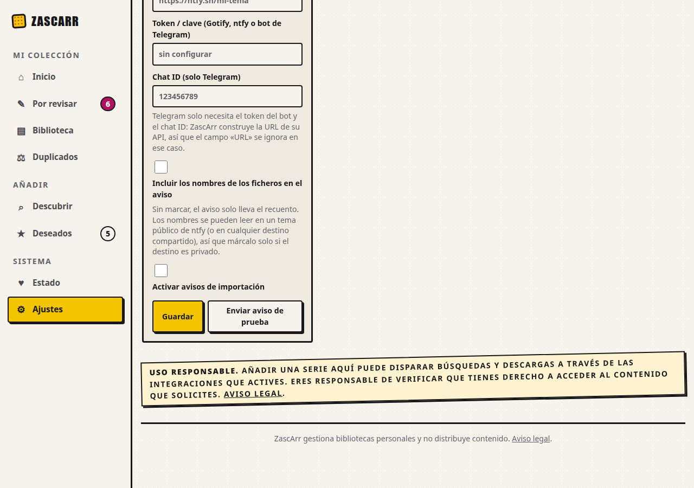
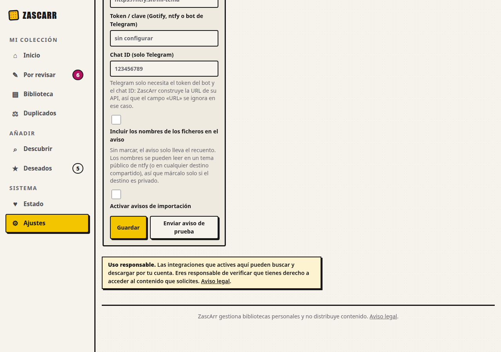

# Evidencia de U17 (#204): leer los avisos y el texto legal sin esfuerzo

Rama `claude/u17-avisos`, 2026-10-17. **Decisión legal citada (DoD):** el responsable eligió el 2026-10-15 la opción **(b)**, una **frase visible con enlace
a «Aviso legal»**, sin plegarla (comentario en #204). **No cambian** `LEGAL.md`, `legal_version` ni `require_legal_acknowledgment`.

| Dato | Valor |
|---|---|
| Antes | `main` `121664ddef66e3fa2ef69eb0a5d0f6d94eb42019` |
| Después | commit funcional **`e545209e52fdb3323c1b50180b7af83276b6d5bb`** de esta rama (los commits posteriores solo tocan `docs/design/ui-u17/`) |
| Entorno | ensayo aislado `docs/design/ui-baseline/ensayo.sh`: aplicación en contenedor **Debian 12 (bookworm)** (comprobado con `os-release`), PostgreSQL real, datos sintéticos; **reconstruido desde cero** para cada lado |
| Navegador | Google Chrome 154.0.8037.92 (en el equipo del desarrollador), viewport emulado: escritorio 1280×900 y estrecha 390×844 (táctil), **claro y oscuro** |
| Herramientas | [`inventariar_u17.py`](inventariar_u17.py) (qué se pinta en mayúsculas o girado, en 14 pantallas), [`capturar_u17.py`](capturar_u17.py) (aviso legal y notas, medidas y capturas) |
| Datos en bruto | `inventario-antes.json`, `inventario-despues.json`, `medida-antes.json`, `medida-despues.json` |

## Vigencia de la auditoría antigua (inventario a `121664d`, no a `a5369ef`)

- **Vigente:** `.caption` y `.legal-notice-warn` compartían una regla (`web.css:498-509`, antes citada como 495-507) con `text-transform: uppercase`,
  `rotate(-1.2deg)` y `letter-spacing: .12em`. Se usaba como **nota de párrafo** en 37 sitios de 16 plantillas.
- **Vigente:** la macro `legal_disclaimer("wishlist")` se pintaba también en **Ajustes** con «Añadir una serie aquí».
- **No es de U17 y no cambia:** los **títulos** (`h1`–`h4`) en mayúsculas (92 casos de más de 3 palabras en las 56 vistas) y rótulos como `.metric-label`
  del panel: la tarjeta habla de **avisos y textos legales**; la regla general de mayúsculas es de U21.
- **Estimación:** el alcance real (una regla CSS, 3 etiquetas en línea, un tipo nuevo de la macro y una plantilla) **no cambia** el 3 / S de la tarjeta.

## Resultados (PASS / FAIL / NOT RUN)

| Criterio | Medido | Resultado |
|---|---|---|
| 1. Un texto de más de una línea va en caja normal y sin giro | Avisos y notas de más de 3 palabras **en mayúsculas o girados**: **40 → 0** en las 56 vistas del inventario (14 pantallas × escritorio/estrecha × claro/oscuro); 40 → 0 también en las 24 vistas de `capturar_u17.py` (Ajustes, Deseados, ficha, Estado, Descubrir, asistente) | **PASS** |
| 1. Los rótulos (≤ 3 palabras) conservan el estilo | las etiquetas de fuente y tradición (`span`) pasan a `.rotulo` (mayúsculas y giro); la prueba exige ≤ 3 palabras | **PASS** (por prueba; en pantalla se ven como antes) |
| 2. El aviso corresponde a la pantalla | Ajustes: «Las integraciones que actives aquí pueden buscar y descargar por tu cuenta…»; **ya no** dice «Añadir una serie aquí» (Deseados sí, y es correcto) | **PASS** |
| 3. Frase visible con enlace a «Aviso legal» | **32 de 36** avisos medidos llevan el enlace «Aviso legal», ninguno dentro de un `
`; **los 4 restantes** son la nota de la ficha de serie, cuyo enlace dice «Fuentes y atribución» (atribución de datos, **sin cambios**) | **PASS** para los avisos legales; la nota de atribución se deja como estaba |
| La aceptación legal protege lo mismo | prueba: las **seis** acciones protegidas (4 POST de Deseados, 2 de la API) son exactamente las de `main`; ni el asistente ni el texto legal están protegidos | **PASS** |

 

## Lo que NO está acreditado

- **Dispositivos reales, Safari/iOS y lector de pantalla: NOT RUN.** Solo Chrome emulado.
- **Estados posteriores a una interacción** (resultados que llegan por HTMX, mensajes de error): no medidos. Cuentan los que cargan con la página; los
  fragmentos que usan `.caption` (p. ej. el resultado de la vinculación) cambian por la misma regla CSS pero **no se han fotografiado**.
- **Tamaño de la letra del aviso (14 px) no se ha tocado**: no es parte del criterio y puede revisarse aparte.
- **Contraste:** la hoja ya pasa `test_web_css_contraste` (caja y color no cambian), pero **no se ha medido el contraste en pantalla**.
- **La Pi:** no se ha tocado.
- **§13 (benchmarking):** no se hizo; es una corrección de CSS y textos con la decisión ya tomada. Lo someto a la revisión.
- **El texto de Ajustes es mío:** el responsable decidió la forma (frase visible con enlace), no las palabras; mantiene la misma responsabilidad que el de
  Deseados («eres responsable de verificar que tienes derecho…») adaptada a Ajustes. Si el responsable legal quiere otra redacción, es un cambio de una línea.

## Pruebas

`tests/test_u17_avisos.py` (16, escritas **antes** del código: 9 fallaban por el comportamiento que faltaba): `.caption` y `.legal-notice-warn` sin
mayúsculas ni giro; `.rotulo` con el estilo de didascalia y ≤ 3 palabras en las plantillas; sin `span.caption`; Ajustes sin «Añadir una serie aquí» y con tipo
propio; la frase legal visible, con enlace y fuera de un `
`; las seis acciones protegidas. Contrato de CSS y plantillas: **no sustituyen la medida
en Chrome**.
