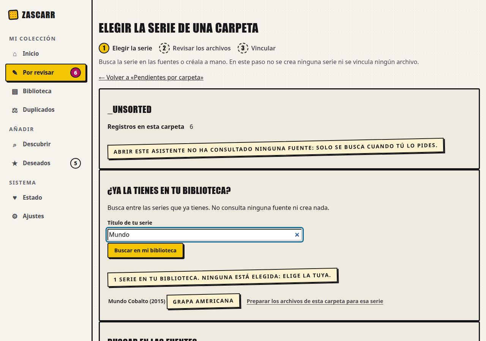
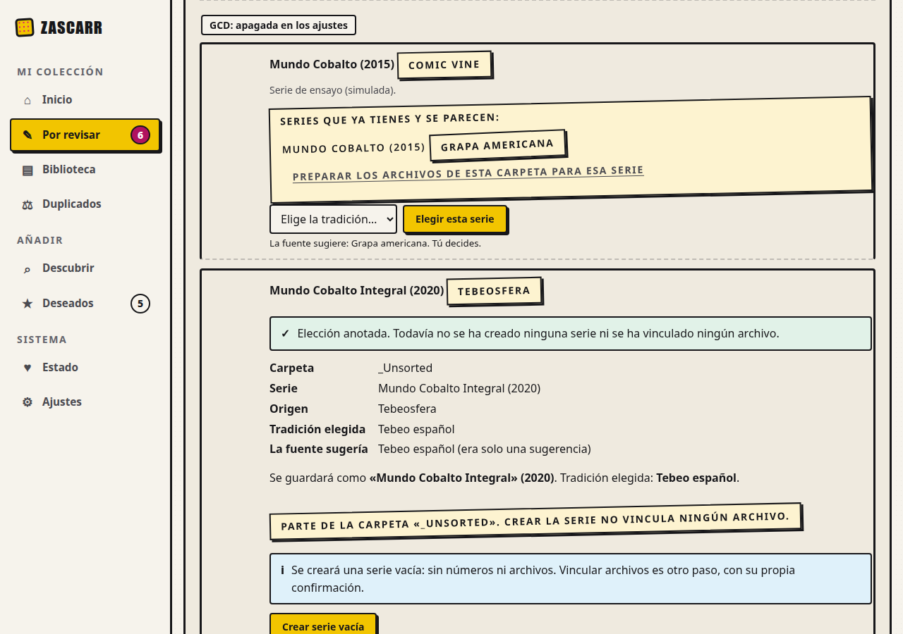
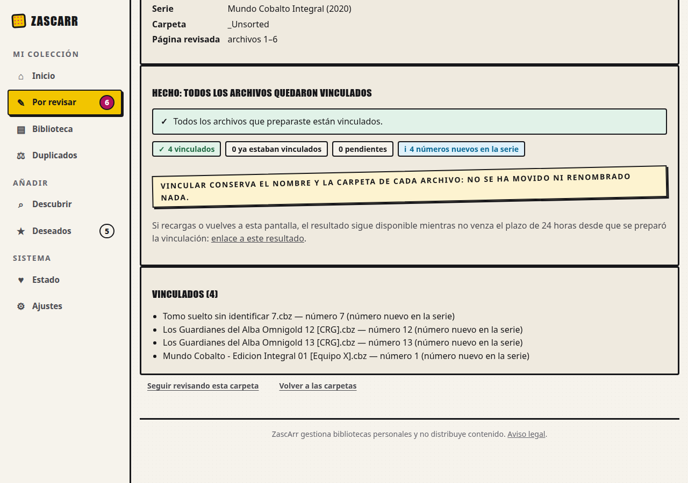
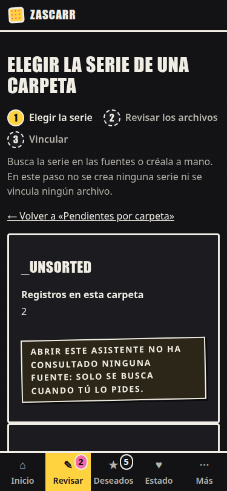

# Evidencia de U19 (#206): de la carpeta a sus archivos vinculados, en navegador real

Rama `claude/u19-recorrido`, 2026-10-16. Código evaluado: `a48fad0` (los commits posteriores solo tocan esta carpeta de
documentación). Ficha y contratos: `docs/design/benchmark-U19-recorrido-vincular.md` (§6.4 y §7.2).

| Dato | Valor |
|---|---|
| Navegador | Google Chrome 154.0.8037.92 **headless por CDP**; escritorio 1280×900 y móvil 375×812 (**emulación de viewport**), claro y oscuro |
| Entorno | ensayo aislado `docs/design/ui-baseline/ensayo.sh` (Postgres real), **rehecho desde cero** para esta ejecución y desmontado después |
| Herramientas | [`fragmentos_u19.py`](fragmentos_u19.py) (genera el fragmento de búsqueda con la ruta real) y [`capturar_u19.py`](capturar_u19.py) |
| Datos en bruto | [`datos.json`](datos.json) |

## Qué es real y qué es simulado (importa)

- **Real:** el servidor del ensayo con su base de datos, hoja de estilos, htmx, la plantilla base y **todas** las rutas de U19
  (series locales, elegir, vista previa por GET, alta, alta reconstruida, revisión, vinculación y lectura del resultado); y las
  **teclas** (Tab y Enter por el protocolo: `Input.dispatchKeyEvent`). **Escribe en el ensayo** (crea una serie y vincula 4
  archivos): es desechable.
- **Simulado:** el ensayo tiene las **cuatro fuentes apagadas a propósito** y su red no está aislada, así que **no las encendí**
  (serían consultas reales a sitios externos; Tebeosfera es una asociación sin ánimo de lucro). El fragmento de
  `POST …/asistente/buscar` lo genera la ruta real con `buscar_a_ritmo` sustituido por una respuesta ya calculada y se sirve al
  navegador con `Fetch.fulfillRequest`. Los tokens de esas dos candidatas los firma la clave del propio ensayo (leída de su base
  de datos y **no guardada** en el repositorio). Por tanto esto acredita la **navegación y el comportamiento del navegador**,
  **no** el contenido ni los tiempos de las fuentes.

## Resultados

| Criterio de #206 | Medido | Resultado |
|---|---|---|
| 1. Serie local sin identificadores, solo con teclado | Tab ×12 hasta el buscador local, «Mundo» + Enter → 1 serie (año y tradición); Tab ×2 → el enlace; Enter → la revisión de esa serie. Sin `checked`/`selected` en ningún sitio; no se creó ninguna serie | PASS |
| 2. Continuidad desde una candidata | Con la 2.ª candidata simulada: tradición elegida **por teclado** («Tebeo» → `tebeo`), Tab, Enter → «Elección anotada…» **y la vista previa del alta** (antes, un callejón: «todavía no está disponible»); el botón «Crear serie vacía» aparece; la serie **no existe** hasta pulsarlo (0 apariciones en Biblioteca) | PASS |
| 2. Recargar la vista previa | El enlace «enlace a esta vista previa» (GET) reconstruye la misma vista previa con «Crear serie vacía» | PASS |
| 2. Crear y seguir | «Crear serie vacía» por teclado → «creada»; «Revisar los archivos de esta carpeta» lleva a la revisión con el **id local** de la serie nueva | PASS |
| 3. Progreso | `aria-current="step"` en exactamente un paso en cada pantalla (A, vista previa, alta reconstruida: 1; revisión: 2; resultado y su lectura: 3); «hecho» solo en los anteriores y «pendiente» en los siguientes, en **texto** además del color | PASS (DOM) |
| 3. El resultado cambia el indicador | Al pulsar «Vincular 4 archivos» la cabecera pasa a «Resultado de la vinculación» y los pasos a «hecho, hecho, actual» (respuesta fuera de banda; antes de esta corrección se quedaba en «Revisar… paso actual») | PASS |
| 4. Un consentimiento por efecto | En el navegador se observó que los dos efectos son **dos botones en dos pantallas distintas** («Crear serie vacía» y «Vincular 4 archivos»), y que la serie no existía tras «elegir» (0 apariciones en Biblioteca). Que navegar y volver **no escribe** se prueba en la base de datos (T7), no en Chrome | PASS (botones); BD en T7 |
| 6. Volver después del alta | La URL de «alta reconstruida» dice «La serie «Mundo Cobalto Integral» (2020) ya está creada… Quedan 6 archivos», sin «Deshacer» | PASS |
| 7. Volver después de vincular | El resultado ofrece «enlace a este resultado»; abrirlo (y **recargarlo**) muestra el mismo informe con «resultado guardado», sin volver a ejecutar | PASS |
| 7. Referencia no válida | Texto único «Esta referencia no es válida. No se ha cambiado nada.», sin ninguna pista y **sin indicador de pasos** | PASS |
| Móvil 375 px, oscuro | Sin scroll horizontal; el indicador baja de línea | PASS |

   

## Lo que NO está acreditado

- **Lector de pantalla (Orca, NVDA, VoiceOver, TalkBack): NOT RUN** para U19. El árbol de accesibilidad de CDP **no expone
  `aria-current`** (solo se vio el atributo en el DOM), así que no tengo una medida de cómo lo verbaliza ningún lector.
- **Vencimiento del resultado en el navegador: NOT RUN.** Esperar 24 h reales no es viable aquí; el límite exacto (`exp−1`,
  `exp`, `exp+1`), la fila aún presente y la integridad antes que el vencimiento se prueban con **tiempo controlado** en
  `tests/test_u19_recorrido_pg.py` (T10), no en Chrome.
- **Fuentes reales:** NOT RUN (ver arriba). La pantalla de resultados de búsqueda se probó con candidatas simuladas.
- Firefox y Safari; un móvil real (solo emulación de viewport); la Pi: **NOT RUN**.
- La cabecera «Elegir la serie de una carpeta» y sus textos de apoyo no se han revisado con una persona real.

## Pruebas

`tests/test_u19_recorrido_pg.py` (34: T8 volver antes del alta, T9 volver después, T10 lectura del comprobante) se escribió **en
rojo antes de implementar** (34 fallos, por las rutas inexistentes). `tests/test_u19_continuidad_pg.py` (selección local, candidata
con carpeta, indicador de pasos, navegar sin escribir, límites) se escribió **después** de implementar esa parte; contra `main`
fallan 14 de 16 (las dos que pasan, T12 y T13, son guardas de invariantes que ya se cumplían). Se comprobó con tres mutaciones
(sin vencimiento, plazo desde la emisión, la lectura escribe) que las pruebas del contrato las detectan.
