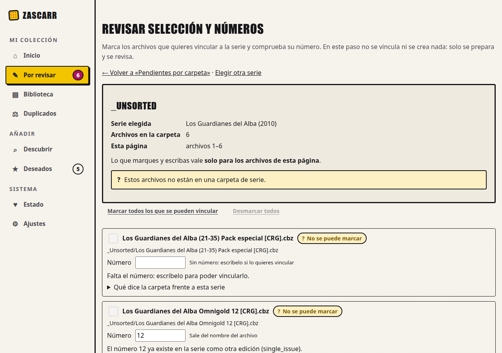
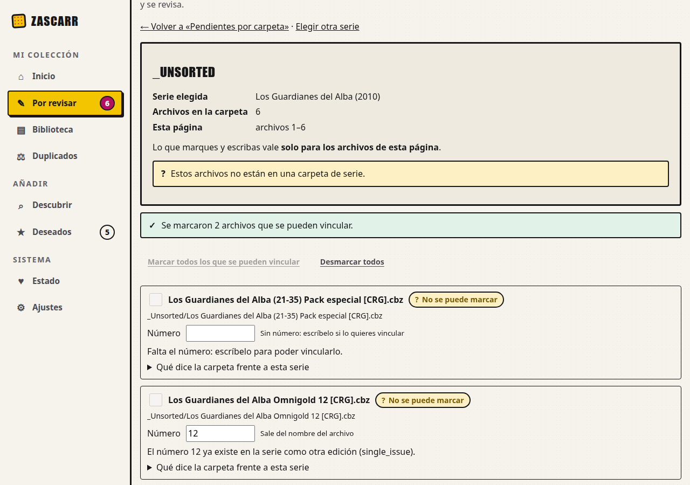
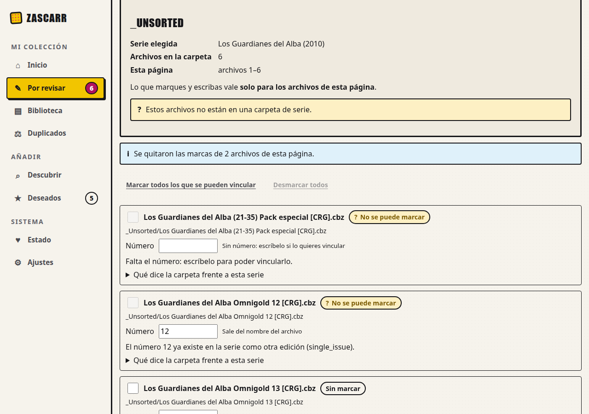

# Evidencia de U20 (#207): marcar todo lo vinculable y revisión sin jerga

Capturas y mediciones en **navegador real** de la rama `claude/u20-marcar-vinculables`, 2026-10-15.

| Dato | Valor |
|---|---|
| Código | `main` en `e65e047` + los cambios de la PR de U20 |
| Entorno | ensayo aislado `docs/design/ui-baseline/ensayo.sh` (Compose `zascarr-uibase`, **Postgres real**, datos **sintéticos**, `127.0.0.1:18000`) |
| Navegador | Google Chrome 154.0.8037.92 headless por CDP, 1280 × 900 |
| Herramienta | [`capturar_u20.py`](capturar_u20.py); los clics son **reales** (`Input.dispatchMouseEvent`) |
| Datos en bruto | [`datos.json`](datos.json) |

## Resultados

Carpeta `_Unsorted` (6 archivos) con la serie «Los Guardianes del Alba (2010)»:

| Paso | Marcados | Marcados que no se pueden vincular | Mensaje del servidor | Botones |
|---|---|---|---|---|
| 0. Abierta | 0 de 6 | 0 | — | «Marcar todos…» activo; «Desmarcar todos» desactivado |
| 1. Tras «Marcar todos los que se pueden vincular» | **2** de 6 | **0** | «Se marcaron 2 archivos que se pueden vincular.» (`data-n="2"`) | «Marcar» desactivado; «Desmarcar» activo |
| 2. Tras «Desmarcar todos» | 0 de 6 | 0 | «Se quitaron las marcas de 2 archivos de esta página.» (`data-n="2"`) | como en 0 |

Los otros 4 no se marcan (el servicio no los da por marcables) y cada uno lo explica en su fila; en las capturas se
ven dos: uno sin número y uno cuyo número ya existe como otra edición. Ninguna pantalla contiene «token», «lote» ni «motivo:» (`texto_visible_con_jerga: []`).

  

## Un hallazgo de esta verificación

La primera captura enseñaba «ya existe en la serie como otra edición (**single_issue**)»: el valor interno del enum
del formato. No lo cazaba la prueba de jerga (no es «token» ni «lote»), pero entra en «códigos internos» del criterio 4.
Se traduce en la capa web (`FORMATOS_LEGIBLES`) y tiene prueba propia.

## Lo que esto no cubre

- **NOT RUN:** la Raspberry Pi del responsable, una carpeta de 155 archivos reales, móviles y lector de pantalla.
- La verificación de la confirmación («Vincular») no se repitió aquí: no cambia, y sus textos se prueban en
  `tests/test_asistente_confirmar_pg.py` con Postgres real.
