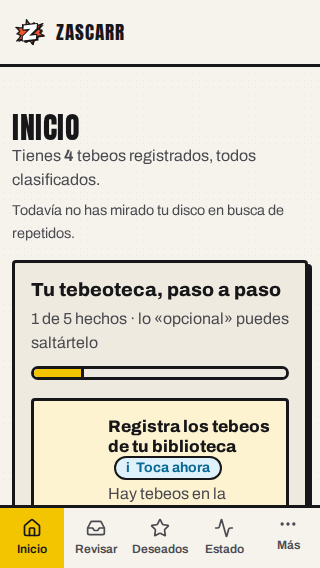
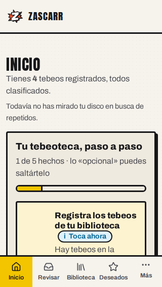
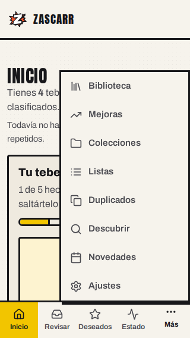
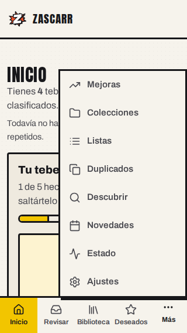

# UXA-08b · «Biblioteca directa» frente a «Más» en móvil (simulación con agentes)

**Fecha:** 2026-11-21 (rondas 1–3); 2026-11-26 (ronda 4) · **Historia:** #1205 · **Origen:** #1125 (UXA-08) · **Estado:** simulaciones hechas (rondas 1–4); **la decisión del PO sigue abierta** y la medición con personas, pendiente.

## Qué se comparó

| Variante | Barra inferior (móvil) | Dentro de «Más» |
|---|---|---|
| **A (hoy)** | Inicio · Revisar · Deseados · Estado · Más | Biblioteca, Mejoras, Colecciones, Listas, Duplicados, Descubrir, Novedades, Ajustes |
| **B (prueba)** | Inicio · Revisar · Biblioteca · Deseados · Más | Mejoras, Colecciones, Listas, Duplicados, Descubrir, Novedades, **Estado**, Ajustes |

B es solo un experimento: se movió `movil_principal` de Biblioteca y de Estado en `web/menu.py` (3 líneas) en una rama local que **no se fusionó ni se publicó**. En B el punto de aviso de Estado (`#cnt-estado`) queda dentro del panel y no se ve desde la barra.

## Método

- Dos instancias locales idénticas (mismo Postgres, 24 series sembradas, incluidas «Flash» y «Flash Gordon»), sin tocar la Pi.
- Cuatro agentes de IA, uno por celda (2 perfiles × 2 variantes), sin saber que se comparaban variantes, en una pestaña propia a 375×812. Podían escribir la URL de partida (`/ui/`) y después solo pulsar lo que veían; máximo 12 clics.
  - **Marta** (58 años, coleccionista, no técnica) y **Dani** (34 años, vigila el servidor).
- Tareas, ambas desde Inicio: abrir la ficha de la serie «Flash» y comprobar si el sistema tiene algún problema o aviso.
- Se registró cada clic, el primero, las dudas y el éxito.

## Resultados

| Perfil · variante | Tarea | Primer clic | Clics hasta la sección | Clics totales | Éxito |
|---|---|---|---|---|---|
| Marta · A | Flash | Más | 2 | 5 | Sí |
| Marta · A | Estado | Estado | 1 | 1 | Sí |
| Dani · A | Flash | Más | 2 | 5 | Sí |
| Dani · A | Estado | Estado | 1 | 1 | Sí |
| Marta · B | Flash | Biblioteca | 1 | 4 | Sí |
| Marta · B | Estado | Más | 2 | 2 | Sí |
| Dani · B | Flash | Biblioteca | 1 | 4 | Sí |
| Dani · B | Estado | Más (un fallo de puntería, descontado) | 2 | 2 (3 con el fallo) | Sí |

- **Éxito:** 8 de 8 en las dos variantes.
- **Biblioteca:** A cuesta 2 clics hasta la lista (Más → Biblioteca), B cuesta 1. En A el primer clic fue siempre «Más», por descarte («no vi nada que dijera Biblioteca»).
- **Estado:** A cuesta 1 clic, B cuesta 2 (Más → Estado). En B ambos fueron a «Más» por descarte.
- **El intercambio es simétrico:** cada variante ahorra un clic en una tarea y lo pierde en la otra.

### Comentarios espontáneos

- En A, los dos pidieron ver Biblioteca en la barra («Me habría gustado ver "Biblioteca" directamente abajo»; «Biblioteca, que es lo que más se usa, queda escondida detrás de "Más"»).
- En B, los dos echaron en falta una señal de Estado fuera de «Más» («un punto en "Más" cuando hay problemas»; «la palabra "Estado" o un aviso se viera sin abrir ese menú»).
- En B, Marta dudó si «Revisar» era lo de los problemas.

### Observación aparte (no depende de la navegación)

En Biblioteca, tras pulsar «Buscar» los resultados quedan bajo la fila de botones y el texto explicativo; tres agentes no vieron cambio hasta desplazarse. Es de la pantalla, igual en A y en B. Candidato a historia propia.

## Límites (qué no demuestra)

- **No son personas.** Son agentes de IA que leen etiquetas: el «primer clic» refleja cómo se leen los rótulos, no el comportamiento, la prisa, el pulgar ni los errores de una persona real. Sirve para detectar problemas de etiquetado, no para medir tiempos ni decidir.
- **n = 1 por celda**, dos perfiles. Ninguna diferencia es estadística.
- Dani en A no pudo hacer capturas (el panel del navegador estaba oculto) y trabajó con el árbol de accesibilidad; los demás vieron la pantalla.
- Varios agentes cargaron la URL de partida más de una vez por fallos de carga; no se contó como clic.
- No se probó móvil real, ni lector de pantalla, ni 320 px.
- Un agente dijo que los enlaces de la barra no tenían nombre accesible; se comprobó y **no es cierto** (el enlace tiene el texto visible; fue una limitación de la herramienta).

## Lectura

La simulación no inclina la balanza por sí sola: el coste se desplaza entre dos tareas. Lo que sí aporta es la **condición para que B sea defendible**: si Biblioteca va directa, Estado necesita una señal visible fuera de «Más» (por ejemplo, el punto de aviso sobre «Más» cuando hay avisos). Sin ella, B empeora el camino a Estado, que el criterio de #1125 pide conservar claro.

## Decisión del PO (pendiente)

1. Mantener A (sin cambios).
2. Probar B **con** el punto de aviso sobre «Más», detrás de una prueba controlada, y medir con personas reales (primer clic y éxito con una persona que lee y otra que opera, en móvil real).
3. Otra variante (p. ej. B cambiando «Inicio» en vez de «Estado»).

Hasta que el PO decida, la navegación por defecto no cambia.

## Ronda 2 (2026-11-21): con el interruptor real y el guion de la prueba

Misma comparación, ya sobre el código fusionado (`NAV_MOVIL_VARIANTE`, #1218), con el guion de `uxa08b-prueba-con-personas.md`: tres tareas (Flash, Estado, Por revisar), orden alternado entre Marta y Dani, cuatro participantes (uno por perfil y variante), tomados de cero. En B el punto de «Más» **no se encendió** (hoy solo responde a seguridad), que es la situación real. Una primera pasada de Dani en A se **descartó**: el panel del navegador estaba oculto y no pudo hacer ningún toque; se repitió.

| Perfil · variante | Tarea | Primer toque | Toques hasta la sección | Toques totales | Fallos de puntería | Éxito |
|---|---|---|---|---|---|---|
| Marta · A | Flash | Más | 2 | 5 | 0 | Sí |
| Marta · A | Estado | Estado | 1 | 1 | 0 | Sí (sin verificar la pantalla) |
| Marta · A | Por revisar | Revisar | 1 | 1 | 0 | Sí |
| Dani · A | Estado | Estado | 1 | 1 | 0 | Sí |
| Dani · A | Flash | Más | 2 | 3 | 3 | Sí |
| Dani · A | Por revisar | Revisar | 1 | 1 | 0 | Sí |
| Marta · B | Flash | Biblioteca | 1 | 6 | 4 | Sí |
| Marta · B | Estado | Más | 2 | 2 | 2 | Sí |
| Marta · B | Por revisar | Revisar | 1 | 1 | 0 | Sí |
| Dani · B | Estado | Más | 2 | 2 | 1 | Sí |
| Dani · B | Flash | Biblioteca | 1 | 4 | 0 | Sí |
| Dani · B | Por revisar | Revisar | 1 | 1 | 0 | Sí |

**Lectura de las dos rondas juntas (8 recorridos por tarea y variante entre las dos rondas, 2 por celda y ronda):**

- **Éxito:** 100 % en las dos variantes y en las tres tareas.
- **Biblioteca:** A siempre 2 toques hasta la lista (Más → Biblioteca), con «Más» como primer toque «por descarte»; B siempre 1.
- **Estado:** A siempre 1; B siempre 2 (Más → Estado), también por descarte.
- **Por revisar** (control): 1 toque en ambas; «Revisar» en la barra y «Por revisar» en el título no confundió a nadie.
- **El resultado no cambió entre rondas:** el coste se desplaza entre Biblioteca y Estado. La simulación **no** desempata.

**Observaciones nuevas**

- Dani en B: «Estado» estaba «casi al final, junto a Ajustes» en un menú de ocho opciones; lo reconoció por el icono de pulso. Pidió «un acceso directo o un aviso visible si algo falla».
- Dani en A: «Estado» abrió con «Atención: VPN, Copias de seguridad, Comprobación de restauración» pero no le quedó claro cuántos avisos hay ni su gravedad.
- Marta en B: tocó «Escaparate» por error al entrar en Biblioteca y la vista le pareció vacía («Todavía no hay actividad…»); tuvo que volver a «Gestión». No tiene que ver con la barra, pero es un tropiezo real de esa pantalla.
- «Más»: dos agentes (uno en A, otro en B) dijeron que no respondía a la primera. Con el panel del navegador oculto no se puede distinguir un fallo de la herramienta de uno real. **A comprobar en móvil real** (anotarlo en la prueba con personas).
- Reapareció que los resultados de «Buscar» quedan bajo los botones (#1214).

**Límites añadidos:** el panel del navegador estuvo oculto durante la ronda; algunos toques fallaron por la herramienta y se cuentan aparte. Sigue siendo una simulación con agentes: n = 1 por celda y ronda, sin tiempos.

**Qué sigue siendo verdad de la decisión:** B solo es defendible con un aviso de salud completo fuera de «Más» (#1219). La prueba con personas reales, con la anotación sobre «Más», sigue pendiente.

## Ronda 3 (2026-11-23): consumidores sintéticos con la técnica SSR (Semantic Similarity Rating)

A petición del PO se aplicó la técnica SSR: perfiles sintéticos → opinión abierta → vector → similitud con cinco frases de referencia → distribución de probabilidad sobre 1–5. Aquí **no se navega**: se muestra la barra (A o B, ya con el punto de salud de #1223/#1225) y se pide una opinión sobre tres situaciones («abrir Flash», «comprobar si algo falla», «qué hago ante el punto de aviso»).

**Montaje.** 8 perfiles (edad 19–72, ingresos, ciudad, soltura tecnológica) × 2 variantes = 16 agentes independientes (modelo pequeño, sin herramientas salvo escribir su JSON), mismo perfil en A y en B (diseño pareado). Tres conjuntos de cinco frases de referencia; probabilidades por desplazamiento al mínimo y normalización, promediadas entre conjuntos; remuestreo (bootstrap, 4000) sobre perfiles. Script y respuestas: `docs/design/uxa08b-ssr/`.

**Desviación importante: el «embedding» no es neuronal.** No hay modelo de embeddings instalado ni se descargó uno sin permiso. Se usó un TF-IDF de n-gramas de caracteres (biblioteca estándar): un proxy **léxico**, no semántico.

### Resultado SSR (valoración de facilidad, 1 = muy difícil … 5 = muy fácil)

| Situación | A: media (IC 95 %) | B: media (IC 95 %) | Δ B − A pareada (IC 95 %) | Perfiles con B > A |
|---|---|---|---|---|
| Abrir la serie «Flash» | 2,89 (2,66–3,10) | 2,81 (2,63–2,98) | −0,08 (−0,36 a +0,21) | 3/8 |
| Comprobar si algo falla | 2,96 (2,82–3,10) | 2,93 (2,76–3,09) | −0,03 (−0,22 a +0,18) | 3/8 |
| Qué hacer ante el punto de aviso | 3,12 (2,86–3,39) | 2,91 (2,69–3,14) | −0,20 (−0,57 a +0,19) | 3/8 |

**Lectura: sin señal.** Las diferencias son minúsculas y sus intervalos incluyen el cero; las distribuciones por respuesta son casi uniformes. No se puede concluir nada de estas cifras.

**Por qué no hay que fiarse de ellas (validez).**
- La comprobación 15/15 («cada frase de referencia se reconoce a sí misma») es **trivial** con un método léxico.
- Con paráfrasis sin palabras compartidas, el orden es el correcto pero muy comprimido: «Me pierdo por completo…» → 2,05 (esperado 1); «Está ahí mismo, un solo toque y listo» → 3,50 (esperado 5); una frase neutra → 3,40 (esperado 3).
- Las respuestas de los agentes **describen el camino** («iría a Más y luego a Biblioteca») más que **valorar** el esfuerzo; SSR está pensado para valoraciones, así que la pregunta debería provocar una valoración explícita («¿te parecería fácil o difícil?») antes de volver a medir.

### Lo que sí aporta: codificación por contenido (no es SSR)

Número de respuestas (de 8) que describen el recorrido por cada ruta:

| Situación | Variante | Pasa por «Más» | Menciona «Biblioteca» | Menciona «Estado» |
|---|---|---|---|---|
| Flash | A | 7 | 8 | 0 |
| Flash | B | 0 | 8 | 0 |
| Comprobar si algo falla | A | 0 | 0 | 8 |
| Comprobar si algo falla | B | 6 | 0 | 8 |
| Punto de aviso | A | 0 | 0 | 7 |
| Punto de aviso | B | 8 | 1 | 7 |

Esto **repite lo observado en las rondas 1 y 2 con navegación real**: A manda a Biblioteca por «Más»; B manda a Estado por «Más», y ante el punto de aviso B exige abrir «Más» primero (8/8), mientras que A va directo a Estado. El intercambio de costes es el mismo.

### Conclusión de la ronda 3
La técnica SSR, **tal como se ha podido ejecutar**, no desempata ni aporta cifras fiables; sirve como confirmación cualitativa de los recorridos. Para que SSR sea informativa hacen falta (1) embeddings neuronales multilingües (hay que bajar un modelo: **pendiente de permiso**) y (2) preguntas que provoquen una valoración. Siguen siendo imprescindibles las personas reales: nada de lo anterior sustituye la prueba de `uxa08b-prueba-con-personas.md`.

## Ronda 4 (2026-11-26): 320 px con agentes sintéticos deterministas

La ronda 3 dejó 320 px fuera. Esta ronda mide ese ancho con dos agentes sintéticos **deterministas y sin LLM**: no había clave de DeepSeek en el entorno y no se quiso enviar nada a un proveedor externo. No son personas ni sustituyen la prueba de `uxa08b-prueba-con-personas.md`; sirven para comprobar etiquetas, recorrido mínimo y encaje de la barra.

**Montaje.** Dos instancias aisladas de UXLab con el mismo Postgres y el mismo fixture (4 series; el objetivo es «Nebulosa de Papel», no «Flash», porque el fixture actual no la incluye), una con `NAV_MOVIL_VARIANTE=a` y otra con `b`. Ninguna publica puertos ni toca la Pi. Dos perfiles (Marta, lectora; Dani, operador) × 2 variantes × 2 tareas = 8 sesiones. Cada sesión parte de Inicio, con un contexto de navegador nuevo, viewport **320×568**, `isMobile` y táctil. El agente busca el rótulo en la barra; si no está, abre «Más» y lo busca en el panel. No hay errores de puntería ni tiempos humanos. Guion, perfiles y código: `uxlab/nav320/`; resultados y capturas: [`uxa08b-320/`](uxa08b-320/).

### Resultados

| Perfil · variante | Tarea | Primer toque | Toques hasta la sección | Toques totales | Éxito |
|---|---|---|---:|---:|---|
| Marta · A | Abrir «Nebulosa de Papel» | Más | 2 | 3 | Sí |
| Marta · A | Estado | Estado | 1 | 1 | Sí |
| Dani · A | Abrir «Nebulosa de Papel» | Más | 2 | 3 | Sí |
| Dani · A | Estado | Estado | 1 | 1 | Sí |
| Marta · B | Abrir «Nebulosa de Papel» | Biblioteca | 1 | 2 | Sí |
| Marta · B | Estado | Más | 2 | 2 | Sí |
| Dani · B | Abrir «Nebulosa de Papel» | Biblioteca | 1 | 2 | Sí |
| Dani · B | Estado | Más | 2 | 2 | Sí |

- **Éxito:** 8 de 8. «Toques totales» incluye abrir la ficha de la serie; «hasta la sección» es llegar a la lista de Biblioteca o a la pantalla Estado.
- **Biblioteca:** A cuesta 2 toques (Más → Biblioteca), B cuesta 1.
- **Estado:** A cuesta 1, B cuesta 2 (Más → Estado).
- **El intercambio es el mismo de las rondas 1–3.** A 320 px no aparece un coste nuevo: el número de toques no cambia.

### Lo que sí aporta la ronda 4: el encaje a 320 px

| Variante | Barra | Desborde horizontal | Rótulos en 2 líneas | Panel «Más» |
|---|---|---|---|---|
| A | Inicio · Revisar · Deseados · Estado · Más | No | Ninguno | 220×390 px; cabe entero |
| B | Inicio · Revisar · Biblioteca · Deseados · Más | No | Ninguno | 220×390 px; cabe entero |

- La barra usa 5 columnas iguales de **64 px**; con la tipografía a **12 px**, «Biblioteca» entra en una línea, pero con poco margen. No hay desborde de la página (`scrollWidth = 320`).
- El panel «Más» mide **220×390 px**, se ancla a la derecha y cabe entre la barra y el borde superior (deja 118 px arriba). En A lleva 8 entradas; en B, 8 con Estado y sin Biblioteca.
- **No se probó** texto ampliado al 200 %, lector de pantalla, pulgar real ni móvil real. El encaje medido es solo el de este viewport.

| A (320 px) | B (320 px) |
|---|---|
|  |  |
|  |  |

### Dudas registradas (texto del agente sintético, no de una persona)

- Marta en A: «No veo “Biblioteca” en la barra; tengo que abrir “Más” y buscarlo»; «Biblioteca, lo que más uso, no está en la barra».
- Dani en A: «“Biblioteca” no está en la barra; lo busco en “Más”».
- Marta y Dani en B: «“Estado” no está en la barra; lo busco en “Más”»; «No hay ninguna señal de Estado a la vista; “Más” no dice si algo falla».
- En B, «Biblioteca» no se partió en dos líneas, pero el margen es estrecho.

### Lectura y límites

La ronda 4 **no desempata**: confirma que B es viable a 320 px y que el coste se desplaza entre Biblioteca y Estado, igual que en las rondas anteriores. La condición para que B sea defendible sigue siendo una señal de Estado visible fuera de «Más» (#1219), y la decisión sigue necesitando la prueba con personas reales de `uxa08b-prueba-con-personas.md`.

**No vale para la aceptación de #1205.** Los agentes son deterministas y sin LLM; no son personas, no miden tiempos ni errores, y no se probó un móvil real. La navegación por defecto sigue siendo A y no se ha cambiado nada en la app. #1205 sigue abierto.
