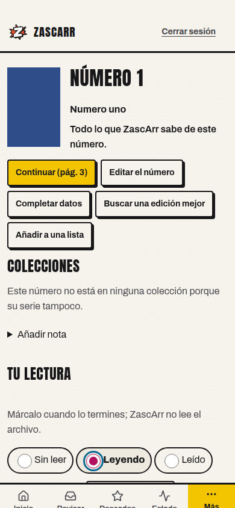

# A6 · Recuperación real en candidata aislada (UATP-06/07)

| Campo | Valor |
|---|---|
| Historias | UATP-06 [#1144](https://github.com/juanajok/zascarr/issues/1144), UATP-07 [#1145](https://github.com/juanajok/zascarr/issues/1145), épica [#1141](https://github.com/juanajok/zascarr/issues/1141) |
| Fecha/hora | 2026-11-22T13:13:39+01:00 |
| Entorno | E-A6 (alias; host local aislado; sin hostname, IP ni ruta). **No** se usó la Pi ni datos reales. |
| Candidata | tag `uat-candidata-20261122`, tag_commit `2c773e53c235812adabc76e76cd3b111d04d4026`, head `2c773e53c235812adabc76e76cd3b111d04d4026`, BUILD_SHA `2c773e53c235812adabc76e76cd3b111d04d4026`, `app_version=1.15.1`, alembic `0052`, image_id `sha256:7be671c1a4dae062db856b70f2f1a457f494cff2624e4f6388796f86864d82b2` |
| Baseline | **no definido**: D-3 sigue pendiente del PO; no se declara tag T1 |
| Tag antiguo | `v1.15.1` (`4f6ccdd310f5a644d19bdc1293327ac60d531b00`): sin lector ni restauración; Alembic llega a `0016` |
| Decisión D-3 | **No aprobada por el PO**. V-03 queda NOT RUN; no se inventa T1. |
| Resultado global | **NOT RUN (parcial honesto).** 24 comprobaciones PASS; V-03 NOT RUN por D-3 y N-01-interfaz NOT RUN por indicación del PO de usar el script. Por §7.7 esto **no** acredita UATP-07 como cumplida. |

## Resumen

Se creó el tag anotado `uat-candidata-20261122` sobre `2c773e53` y se levantó **E-A6**, un
proyecto Docker aislado (`zascarr-a6`, puertos 15432/18000, volúmenes y estado propios) con la
imagen construida con `BUILD_SHA=2c773e53c235812adabc76e76cd3b111d04d4026`. La matriz negativa (SHA incorrecto, gzip
truncado, `series` ausente y `issues` ausente) se ejecutó por `restaurar_datos.sh --produccion`:
las cuatro filas salieron con `rc=1`, `copia_no_valida`, la `comprobacion` correcta,
`base_en_su_sitio=true` y **cero eventos de contenedor provocados por el intento**; B0, su
manifiesto, `copias.json`, la base viva, las filas testigo y el CBZ quedaron idénticos. Después se
restauró B0 (control positivo: `hecha`, recuentos 2/2/2) y se comprobó la ficha y el lector en la
página guardada (P=3 de 6) con Chrome real. La copia manual de la biblioteca a un volumen Docker
vacío en otro sistema de archivos conservó inventario, mtime con nanosegundos y SHA-256. Queda
**NOT RUN** solo V-03 (falta la decisión D-3 del PO sobre el tag baseline) y la ejecución de N-01
desde la interfaz (el PO pidió el camino del script; el auxiliar ops del host no está instalado en
E-A6). Nada NOT RUN se convierte en PASS.

## Tabla de comprobaciones

Evidencia canónica: [`evidencia/resultado.txt`](evidencia/resultado.txt); datos estructurados:
[`evidencia/negativas.json`](evidencia/negativas.json),
[`evidencia/instantaneas.json`](evidencia/instantaneas.json).

| ID | Qué comprueba | Esperado | Obtenido | Resultado | Evidencia |
|---|---|---|---|---|---|
| V-01 | Identidad de C | tag_commit == head == BUILD_SHA; app_version coincide; alembic coincide | Las cuatro igualdades se cumplen; image_id registrado | **PASS** | `resultado.txt` §V |
| V-02 | T0 `v1.15.1` sin lector ni restore | ausencia verificada | `web/lector.py` y `services/ops_host.py` ausentes; Alembic máx. `0016` | **PASS** | `resultado.txt` §V |
| V-03 | T1 arranca con el catálogo restaurado | T1 definido por el PO (D-3) | No hay T1: D-3 pendiente | **NOT RUN** (`motivo=pendiente_po`) | `resultado.txt` §V |
| N-01-interfaz | N-01 desde la acción «Restaurar…» | acción de interfaz | No ejecutada: el PO pidió `--produccion`; auxiliar ops no instalado | **NOT RUN** (`motivo=no_aplica`) | este documento |
| N-01 | SHA incorrecto | `copia_no_valida`/`sha256_copia`/base `true`/0 eventos | rc=1; estado correcto; eventos del intento=0 | **PASS** | `evidencia/negativas.json`, `eventos-resumen.txt` |
| N-02 | gzip truncado | `copia_no_valida`/`gzip_cabecera`/base `true`/0 eventos | rc=1; estado correcto; eventos del intento=0 | **PASS** | `evidencia/negativas.json` |
| N-03a | Falta `series` | `copia_no_valida`/`tablas_dump`/base `true`/0 eventos | rc=1; estado correcto; eventos del intento=0 | **PASS** | `evidencia/negativas.json` |
| N-03b | Falta `issues` (D-6a) | ídem | rc=1; estado correcto; eventos del intento=0 | **PASS** | `evidencia/negativas.json` |
| N-04 | Control positivo con B0 | `hecha`, recuentos, base `true` | rc=0; `hecha`; series=2 issues=2 files=2 | **PASS** | `evidencia/ops-restaurar-n04.json` |
| S-01 | Instantánea antes/después | idéntica en N-01…N-03 | 8/8 grupos idénticos, salud incluida | **PASS** | `evidencia/instantaneas.json` |
| S-02 | `copias.json` sigue ofreciendo B0 | B0 presente, SHA-256 igual | B0 presente; SHA y manifiesto sin cambios | **PASS** | `resultado.txt` §S/D |
| S-03 | Sin eventos ni escrituras del intento | 0 eventos propios | 0 eventos propios (4 filas); los crudos son sondas de HEALTHCHECK | **PASS** | [`evidencia/eventos-resumen.txt`](evidencia/eventos-resumen.txt) |
| D-01 | B0 y manifiesto intactos | mismos SHA-256 | idénticos antes y después de cada fallo | **PASS** | `resultado.txt` §S/D |
| F-01 | Raíces, destino vacío/distinto, espacio | 1 raíz; D1 vacío; otro FS; espacio | 1 raíz (`/biblioteca`); D1 vacío; st_dev 66309≠66310; 11,2 GB libres | **PASS** | [`evidencia/copia-archivos.txt`](evidencia/copia-archivos.txt) |
| F-02 | Mtime e inventario | idénticos | inventario `7bb7359ab4230628…` idéntico; `st_mtime_ns` idéntico | **PASS** | `evidencia/copia-archivos.txt` |
| F-03 | SHA testigo CBZ y página P | idénticos | CBZ `9a6edec49594b4d2…`; página 3 `5dea59a8fe6656de…` idénticos | **PASS** | `evidencia/copia-archivos.txt`, `resultado.txt` §R |
| F-04 | SHA-256 de toda la raíz (opcional) | idéntico o NOT RUN | R1=D1=`b0a892374b76a3a7…` | **PASS** | `evidencia/F04-y-espacio.txt` |
| R-01 | Ficha ofrece «Continuar (pág. 3)» | presente | presente (HTTP y captura) | **PASS** | `resultado.txt` §R, `evidencia/capturas/` |
| R-02 | Lector abre en P=3 | `data-pagina="3"`, `data-total="6"` | presente; contador «Página 3 de 6» | **PASS** | `resultado.txt` §R, `evidencia/capturas/` |
| R-03 | Página P con SHA testigo; archivo restaurado | coinciden | página 3 `5dea59a8fe6656de…`; archivo `9a6edec49594b4d2…` | **PASS** | `resultado.txt` §R |
| R-04 | Relaciones y progreso | coinciden, sin huérfanos | `current_page=3`, `status=reading`, huérfanos 0 | **PASS** | `resultado.txt` §R |
| R-05 | Recuentos y Alembic del catálogo restaurado | coinciden con B0 | alembic 0052; series=2 issues=2 files=2 library_roots=1 | **PASS** | `resultado.txt` §R |
| A-01 | `resultado.md` y `resultado.txt` existen | presentes y enlazados | presentes; mtime igualado | **PASS** | este documento / `evidencia/resultado.txt` |
| A-02 | Saneado | grep sin coincidencias | 0 coincidencias | **PASS** | `resultado.txt` §A |
| A-03 | Diagnóstico por intento | `intento`/`comprobacion`/`copia_version` | 5 intentos en `.jsonl`; estado con las tres claves | **PASS** | `evidencia/intentos-restauracion.jsonl` |
| A-04 | Línea `CHECK` por comprobación | todas las obligatorias | 25 obligatorias con `CHECK` (V-03 incluida) | **PASS** | `evidencia/resultado.txt` |

## Instantánea antes/después

| Grupo | Qué se comparó | N-01…N-03 (S0 vs S1) |
|---|---|---|
| Código | `HEAD`, árbol limpio | idéntico |
| BD | `alembic_version` y recuentos `series/issues/files/reading_progress/runtime_settings/library_roots` | idéntico |
| Testigo | `file_size_bytes`, `file_mtime_ns`, `sha256_hash`, `issue_id` | idéntico |
| Progreso | `current_page`, `status`, `file_id`, `last_read_at` | idéntico |
| Salud | `status`, `version`, `checks.*` | idéntico (incluido `checks.restore`, que no cambió en esta ejecución; se declara volátil por diseño) |
| Copias | SHA-256 de B0, manifiesto, `status.json`, `copias.json`; B0 ofrecida | idéntico |
| Archivos | SHA-256 y `mtime_ns` del CBZ testigo | idéntico |
| Contenedores | `State.Status`, `RestartCount`, `StartedAt` de app y PostgreSQL | idéntico |

En el cambio de montaje para montar el destino restaurado (F) y en N-04 el contenedor de la app se
recrea/reinicia de forma controlada; por eso `StartedAt` cambia entre S2 y S3. Es el único campo que
cambia; `checks.restore` se declara volátil por diseño aunque en esta ejecución no cambió. Los grupos
de datos siguen idénticos (ver `evidencia/instantaneas.json`).

## Versión declarada

| Campo | Valor | Regla |
|---|---|---|
| tag | `uat-candidata-20261122` (anotado) | `git cat-file -t` = `tag` |
| tag_commit | `2c773e53c235812adabc76e76cd3b111d04d4026` | = HEAD en la ejecución |
| head | `2c773e53c235812adabc76e76cd3b111d04d4026` | = tag_commit |
| build_sha | `2c773e53c235812adabc76e76cd3b111d04d4026` | = head (BUILD_SHA de la imagen) |
| app_version | `1.15.1` | = `pyproject.toml` = `/api/health.version` |
| alembic | `0052` | = manifiesto B0 = BD restaurada |
| image_id | `sha256:7be671c1a4dae062db856b70f2f1a457f494cff2624e4f6388796f86864d82b2` | informativo |

No se declara la copia solo como «1.15.1»: la identidad es la tupla completa. B0
(`backup-20261122_130727`, `sha256 974d82c1d673760b…`, 17837 bytes) se creó con `backup.sh`;
sin disco offsite terminó con `offsite_mount_missing` (copia local y manifiesto ya escritos), lo
que se registra y **no** invalida B0.

## Copia de archivos (UATP-07, D-1)

- **R1**: única raíz de biblioteca del ensayo, `path=/biblioteca`, `enabled=true`, `is_default=true`.
- **D1**: volumen Docker `zascarr-a6-biblioteca`, **vacío** antes de copiar, montado en la misma ruta
  de contenedor (`/biblioteca`), en otro sistema de archivos (`st_dev` 66309 frente a 66310).
- **Copia**: `rsync -aH --numeric-ids` en un contenedor auxiliar (el host no tiene un destino
  escribible en otro dispositivo); `rsync_rc=0`. Se usó `-aH` porque el destino no admite los xattrs
  `$LX*` sintéticos del origen NTFS; la spec permite `-aH` en ese caso.
- **Inventario**: 2 ficheros, 4229 bytes; hash `mtime+tamaño` idéntico R1/D1 (`7bb7359ab4230628…`);
  SHA-256 completo de la raíz idéntico (`b0a892374b76a3a7…`); `st_mtime_ns` del testigo idéntico
  (`1795349115750528900`); SHA-256 del CBZ `9a6edec49594b4d2…`.
- Tras restaurar el catálogo, D1 conserva el mismo inventario y el mismo SHA del CBZ.

## Reapertura en la página guardada

`file_id=a6000000-0000-4000-8000-000000000021`, `issue_id=a6000000-0000-4000-8000-000000000011`,
P=3, total=6. La ficha muestra «Continuar (pág. 3)»; el lector abre con `data-pagina="3"` y sirve la
página 3 con `sha256=5dea59a8fe6656de…`; `files.sha256_hash` coincide con el archivo restaurado y el
progreso (`current_page=3`, `status=reading`) sobrevive a la restauración. Capturas con Chrome real
(`evidencia/capturas/`):

## Pendientes y bloqueos

| Qué | Estado | Motivo / qué falta |
|---|---|---|
| V-03 (T1 baseline) | NOT RUN | `pendiente_po`: D-3 sin aprobar; no se define T1 ni se inventa su arranque |
| N-01 desde la interfaz | NOT RUN | `no_aplica`: el PO pidió el camino `restaurar_datos.sh --produccion`; el auxiliar ops del host no está instalado en E-A6 |
| Health `backup`/`restore` = `error` | esperado en E-A6 | no hay timer de copias ni dispatcher de restauración; `checks.database=ok` |
| Offsite de `backup.sh` | `offsite_mount_missing` | E-A6 no monta disco offsite; la copia local B0 quedó válida |

Nada de lo NOT RUN se convierte en PASS; por la regla §7.7 la historia UATP-07 no se declara
cumplida mientras V-03 siga pendiente de la decisión D-3.

## Enlaces

- Issues: [#1144](https://github.com/juanajok/zascarr/issues/1144), [#1145](https://github.com/juanajok/zascarr/issues/1145), [#1141](https://github.com/juanajok/zascarr/issues/1141).
- Especificación: [`docs/design/uatp06-07-recuperacion.md`](../../design/uatp06-07-recuperacion.md).
- Runbook E2E: [`docs/TESTING_E2E.md` §17](../../TESTING_E2E.md).
- Pruebas PG del flujo: [`tests/test_restaurar_produccion_pg.py`](../../../tests/test_restaurar_produccion_pg.py).
- Evidencia: [`evidencia/resultado.txt`](evidencia/resultado.txt), [`evidencia/versiones.txt`](evidencia/versiones.txt),
  [`evidencia/comandos.txt`](evidencia/comandos.txt), [`evidencia/instantaneas.json`](evidencia/instantaneas.json),
  [`evidencia/copia-archivos.txt`](evidencia/copia-archivos.txt), [`fixture/`](fixture/).
